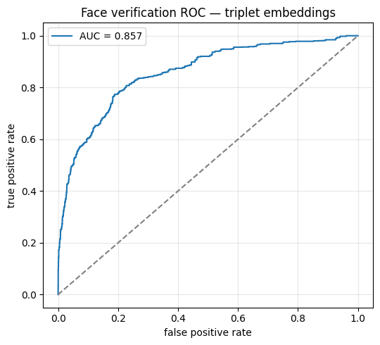
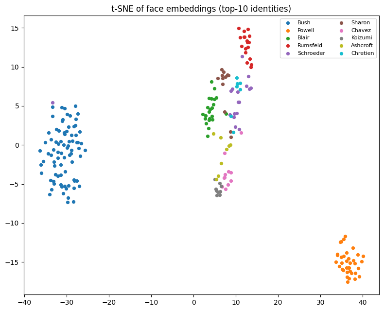

# Face Recognition with Deep Learning

A face recognition project that learns discriminative face embeddings using a pretrained ResNet-18 and triplet loss. The goal is to map face images into a normalized embedding space where images of the same identity have higher cosine similarity than images of different identities.

## Overview

This project implements a metric learning pipeline using the **Labeled Faces in the Wild (LFW)** dataset.

Instead of directly classifying faces into identity classes, the model learns a feature representation that can be used for face verification by comparing embedding vectors.

### Key Features

- LFW dataset loading and preprocessing.
- Pretrained ResNet-18 as the embedding backbone.
- Triplet dataset sampling with anchor, positive, and negative images.
- Metric learning with triplet margin loss.
- AdamW optimization and cosine annealing learning rate scheduling.
- Best-checkpoint selection based on validation loss.
- Face verification evaluation using ROC curves and AUC.
- Embedding visualization using t-SNE.

## Methodology

### 1. Dataset

The project uses the [Labeled Faces in the Wild (LFW)](https://scikit-learn.org/stable/modules/generated/sklearn.datasets.fetch_lfw_people.html) dataset through `sklearn.datasets.fetch_lfw_people`.

The dataset loader returns:

- `images`: RGB face images represented as NumPy arrays with `uint8` pixel values in the range 0–255.
- `labels`: Integer identity labels.
- `class_names`: Names corresponding to the identity labels.

Images are loaded with `color=True`, `resize=1.0`, and `funneled=True`.

### 2. Model Architecture

The embedding network uses a pretrained ResNet-18 backbone.

```python
class EmbeddingNet(nn.Module):
    def __init__(self, embedding_dim=EMBEDDING_DIM, pretrained=True):
        super().__init__()
        weights = models.ResNet18_Weights.DEFAULT if pretrained else None
        backbone = models.resnet18(weights=weights)
        backbone.fc = nn.Linear(backbone.fc.in_features, embedding_dim)
        self.backbone = backbone

    def forward(self, x):
        return F.normalize(self.backbone(x), p=2, dim=1)
```

The original classification layer is replaced with a linear projection to the desired embedding dimension. L2 normalization constrains each output embedding to unit length.

For two normalized embeddings \(z_i\) and \(z_j\), cosine similarity is:

\[
s(z_i,z_j)=z_i^\top z_j
\]

A higher similarity indicates greater similarity between the two face representations.

### 3. Triplet Dataset

Each training sample consists of three images:

- **Anchor:** A reference face.
- **Positive:** Another image of the same identity.
- **Negative:** An image belonging to a different identity.

The `TripletDataset` class samples positive images from the anchor's identity and negative images from another identity. Image transformations are applied when loading each image.

### 4. Training

The network is trained using `torch.nn.TripletMarginLoss`.

Where:

- \(a\): Anchor embedding.
- \(p\): Positive embedding.
- \(n\): Negative embedding.
- \(d\): Euclidean distance.
- \(m\): Margin between positive and negative distances.

The objective is to bring embeddings of the same identity closer together while pushing embeddings of different identities farther apart.

**Training configuration:**

| Component | Configuration |
|---|---|
| Backbone | ResNet-18 |
| Initialization | ImageNet pretrained weights |
| Learning objective | Triplet margin loss |
| Optimizer | AdamW |
| Weight decay | 0.0001 |
| Learning rate scheduler | CosineAnnealingLR |
| Checkpoint selection | Lowest validation loss |

The best checkpoint is saved to `models/triplet.pt`, including the model state dictionary, identity names, image size, embedding dimension, and validation loss.

### 5. Inference

The trained network converts a face image into an L2-normalized embedding vector.

For face verification, embeddings from two face images can be compared using cosine similarity. A similarity threshold can then be selected to determine whether the faces are likely to belong to the same identity.

The threshold should be calibrated on validation data rather than assumed to be universally applicable.

### 6. Evaluation

The evaluation notebook assesses the learned embedding space using two complementary visualizations.

#### Face Verification ROC Curve



The ROC curve illustrates the trade-off between the true positive rate and false positive rate across similarity thresholds.

The AUC (Area Under the ROC Curve) summarizes the model's ability to rank same-identity pairs above different-identity pairs. A higher AUC indicates better pairwise discrimination.

The evaluation procedure samples 3,000 positive pairs and 3,000 negative pairs from the test embeddings, then calculates cosine similarities and the ROC-AUC score.

#### t-SNE Embedding Visualization



t-SNE projects high-dimensional face embeddings into two dimensions to help visualize their structure.

The plot displays embeddings for the ten most frequent identities in the test set. Ideally, images belonging to the same identity form distinct clusters, although t-SNE is a qualitative visualization and does not independently establish verification performance.

## Project Structure

```text
face_recognition/
├── 1. data.ipynb
├── 2. model.ipynb
├── 3. dataset.ipynb
├── 4. train_triplet.ipynb
├── 5. embedding_inference.ipynb
├── 6. eval.ipynb
├── scripts/
│   ├── data.py
│   └── model.py
├── data/
├── models/
├── misc/
│   ├── auc.png
│   └── tsne.png
└── README.md
```

### Notebook Guide

| Notebook | Description |
|---|---|
| `1. data.ipynb` | Load and inspect the LFW dataset. |
| `2. model.ipynb` | Define and inspect the embedding network. |
| `3. dataset.ipynb` | Implement and inspect triplet sampling and image transformations. |
| `4. train_triplet.ipynb` | Train the embedding network and save the best checkpoint. |
| `5. embedding_inference.ipynb` | Generate face embeddings using the trained model. |
| `6. eval.ipynb` | Evaluate verification performance and visualize embeddings. |

### Python Scripts

- `scripts/data.py`: Contains the LFW data loader and associated data utilities.
- `scripts/model.py`: Contains the embedding model and associated model utilities.

## Getting Started

### Requirements

- Python 3.12
- PyTorch
- Torchvision
- scikit-learn
- NumPy
- Pillow
- Matplotlib
- tqdm

Install the main dependencies using `uv`:

```bash
uv init
uv add torch torchvision scikit-learn numpy pillow matplotlib tqdm
```

Run the notebooks in numerical order, starting with `1. data.ipynb`.

The LFW dataset is downloaded and cached by scikit-learn when necessary. Training generates the best model checkpoint at `models/triplet.pt`. The evaluation notebook generates the ROC and t-SNE visualizations used in this README.

Ensure that `misc/auc.png` and `misc/tsne.png` exist before viewing the rendered visualizations on GitHub.

## Limitations

- LFW is a relatively small benchmark compared with modern large-scale face recognition training datasets.
- Random triplet sampling may produce many easy triplets that contribute little to learning.
- Verification performance depends on the identities, data split, preprocessing, and selected similarity threshold.
- t-SNE plots are sensitive to their configuration and should be interpreted qualitatively.
- Results on LFW do not establish production-level accuracy, robustness, or suitability for identity verification in real-world KYC systems.

## Technologies

Python · PyTorch · Torchvision · ResNet-18 · Metric Learning · Triplet Loss · scikit-learn · NumPy · Matplotlib